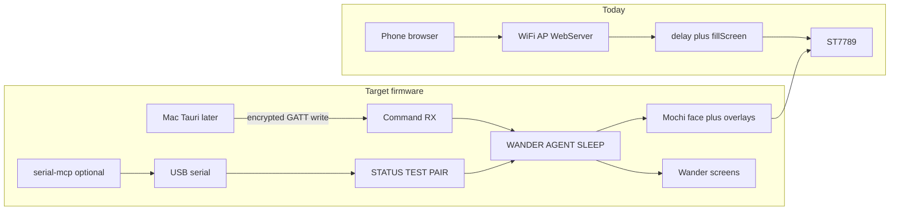
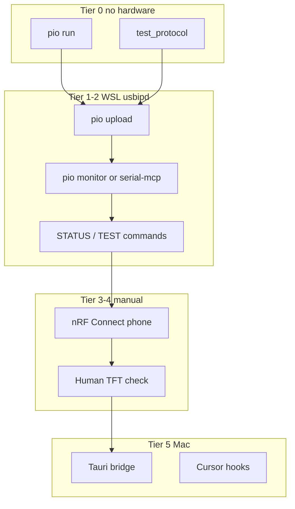

> **Snapshot (2026-08-30):** Copied from the Cursor plan for reference. Original: `~/.cursor/plans/desk_pet_firmware_ae7f1911.plan.md`

---
name: Desk Pet Firmware
overview: Turn the forked Clawd Mochi sketch into pioarduino ESP32-C3 firmware (BLE-first desk pet per PRD), with WSL-first validation via usbipd + serial diagnostics so agents can verify behavior before the Mac bridge exists.
todos:
  - id: linear-project-meta
    content: "Set Claude Mochi Deskpet project summary; move project to In Progress"
    status: completed
  - id: linear-milestones
    content: "Create 7 PRD milestones in Linear (Phase 1–7, Mac phases marked deferred)"
    status: completed
  - id: linear-issues-firmware
    content: "Create HEN Feature issues for each firmware phase; link to milestones"
    status: completed
  - id: linear-issues-mac-deferred
    content: "Create deferred issues for Tauri bridge, Cursor hooks, Mac BLE E2E (no implementation yet)"
    status: completed
  - id: git-init
    content: "Initialize git repo; extend .gitignore for .pio/, build artifacts"
    status: completed
  - id: pio-scaffold-ini
    content: "Add platformio.ini with pioarduino stable URL, esp32-c3-devkitm-1, USB CDC flags, lib_deps"
    status: completed
  - id: pio-scaffold-src
    content: "Create src/ module tree per PRD (main.cpp, clawd_mochi_base/, transport/, extensions/, utils/)"
    status: completed
  - id: recovery-sketch
    content: "Copy clawd_mochi.ino to sketches/clawd_mochi_recovery/ for Arduino IDE Wi-Fi recovery"
    status: completed
  - id: port-display
    content: "Extract Display.cpp/.h — SPI pins, ST7789 init, backlight GPIO3, initColours from clawd_mochi.ino"
    status: completed
  - id: port-face-logo
    content: "Extract Face.cpp/.h — eyes, squish, logo PROGMEM, drawNormalEyes/drawSquishEyes/drawLogoFilled"
    status: completed
  - id: remove-wifi-web
    content: "Remove WiFi/WebServer/HTML from production src; no soft AP in shipping firmware"
    status: completed
  - id: pio-build-tier0
    content: "First pio run -e esp32-c3-super-mini; record flash/RAM usage in README or docs"
    status: completed
  - id: test-protocol-scaffold
    content: "Add test/test_protocol host tests (PlatformIO Unity or native) for JsonProtocol + state machine"
    status: completed
  - id: test-json-malformed
    content: "Unit tests — malformed JSON, missing fields, oversize payload, ACK error shapes"
    status: completed
  - id: test-state-transitions
    content: "Unit tests — WANDER/AGENT/SLEEP transitions, attention timer reset rules"
    status: completed
  - id: serial-boot-banner
    content: "Serial boot banner (fw version, MAC suffix, free heap); wait for USB CDC if needed"
    status: completed
  - id: serial-status-json
    content: "Serial STATUS command returns JSON — mode, state, expression, backlight, ble_connected, pairing_active"
    status: completed
  - id: serial-recovery-cmds
    content: "Serial commands PAIR, UNBOND, SLEEP, WAKE, HELP with redacted logging"
    status: completed
  - id: serial-ascii-debug
    content: "DEBUG build flag — optional ASCII face preview on serial after draw (for agent/human checks)"
    status: completed
  - id: serial-test-face-cmds
    content: "Serial TEST coding|thinking|idle|waiting|error|security — force expression without BLE"
    status: completed
  - id: state-machine-core
    content: "States.cpp — WANDER / AGENT / SLEEP enum, transitions, current agent state"
    status: completed
  - id: nonblocking-loop
    content: "Replace delay() animations with millis() tickers; loop serves BLE + serial + render"
    status: completed
  - id: ble-gatt-uuids
    content: "BleTransport — PRD service/characteristic UUIDs, Command RX, Status TX, Config RX"
    status: completed
  - id: ble-advertise-name
    content: "Advertise as DP-<last4-MAC>; include service UUID; no sensitive data in adv payload"
    status: completed
  - id: ble-security-pairing
    content: "BleSecurity — LE SC, bonding, encrypted/auth chars, 120s pairing window, TFT passkey display"
    status: completed
  - id: ble-nvs-bonds
    content: "Persist bonds in NVS; UNBOND clears; reject unbonded writes/notifications"
    status: completed
  - id: ble-json-protocol
    content: "JsonProtocol — parse BLE writes; emit Status TX ACKs; wire to state machine"
    status: completed
  - id: boot-gesture-pair
    content: "GPIO9 long-press while running opens pairing window (recovery path per PRD)"
    status: completed
  - id: wander-screens
    content: "WanderScreens — idle face, quote, ambient; 15s cycle; runs when BLE disconnected"
    status: completed
  - id: quota-bar
    content: "Quota.cpp — compact color bar from Mac-provided values (serial/BLE test payload first)"
    status: completed
  - id: attention-escalation
    content: "Attention.cpp — 2m/5m/10m escalation; reset on attentionCleared/session events"
    status: completed
  - id: security-overlay
    content: "SecurityEvents.cpp — 10–30s alert screen; type label only; no sensitive details"
    status: completed
  - id: backlight-sleep
    content: "Backlight.cpp — 100% / dim / off; SLEEP mode; serial SLEEP/WAKE"
    status: completed
  - id: dirty-region-render
    content: "Incremental redraw for blink/pulse; avoid full fillScreen in steady state"
    status: completed
  - id: wsl-usbipd-doc
    content: "docs/wsl-validation.md — usbipd bind/attach, /dev/ttyACM0, BOOT button, pio upload/monitor"
    status: completed
  - id: agent-serial-mcp
    content: "Document optional serial-mcp in .cursor/mcp.json (user approves install); example transact flows"
    status: pending
  - id: readme-pioarduino
    content: "Rewrite README — pioarduino build/upload, serial diagnostics, recovery sketch, Mac deferral"
    status: pending
  - id: validate-tier0-ci
    content: "CI or local script — pio run + test_protocol (no hardware)"
    status: completed
  - id: validate-tier1-wsl-flash
    content: "Manual — usbipd attach, pio upload, boot banner on monitor (hardware)"
    status: completed
  - id: validate-tier2-serial
    content: "Manual/agent — STATUS + TEST commands match expected JSON/ASCII (hardware)"
    status: completed
  - id: validate-tier3-ble-phone
    content: "Manual — nRF Connect advertise/pair/encrypted write/reboot reconnect (phone)"
    status: pending
  - id: validate-tier4-display
    content: "Manual — human confirms TFT expressions match agent state (hardware)"
    status: pending
isProject: false
---

# ESP32 Desk Pet Firmware Plan

Turn this Clawd Mochi fork into the ESP32 firmware described in [docs/esp32-desk-pet-prd.md](docs/esp32-desk-pet-prd.md): a BLE-first desk pet with original Mochi graphics, agent-state expressions, wander screens, attention escalation, and security alerts. Validate on **WSL + usbipd** before the MacBook is required for the Tauri bridge.

## What exists today

The repo is not a git repository. It is essentially:

- [clawd_mochi.ino](clawd_mochi.ino) (~1088 lines): Adafruit ST7789 240x240, original eye/logo drawing, blocking `delay()` animations, Wi-Fi AP `ClaWD-Mochi` + embedded web controller
- [README.md](README.md): Arduino IDE 2 flash instructions and verified wiring
- [docs/esp32-desk-pet-prd.md](docs/esp32-desk-pet-prd.md): target product and architecture

Original hardware mapping (keep unchanged):

- SCLK GPIO8, MOSI GPIO10, CS GPIO4, DC GPIO1, RST GPIO2, BLK GPIO3
- `SPI.begin(8, -1, 10, TFT_CS)`, `tft.init(240, 240)`, `setSPISpeed(40000000)`, `setRotation(1)`

Current control path is Wi-Fi only: `setup()` starts a soft AP, `loop()` is `server.handleClient()`. Animations block with `delay()` and `fillScreen()`. That cannot coexist with BLE reconnect or 1-second agent updates.

**Serial today:** only `Serial.begin(115200)` — no logs. Agents cannot observe runtime behavior without new diagnostics.



## Environment on this machine

Ready:

- Cursor extension `pioarduino.pioarduino-ide` 1.4.4
- pioarduino core **6.1.19** at `~/.platformio/penv`
- Python 3.14, Node 26.8, Java via mise
- Linuxbrew + mise on PATH

Not ready / constrained:

- No `~/.platformio/platforms` yet — first `pio run` downloads toolchain
- `~/.platformio/penv/bin` not on bash PATH — use `~/.platformio/penv/bin/pio` or pioarduino IDE UI
- WSL2: flash/monitor via **usbipd-win** (device attached to WSL as `/dev/ttyACM0`)
- BLE encrypted pairing with Mac bridge — **Mac Tier 5** only; phone nRF Connect for Tier 3
- No agent-visible **pixel** stream unless firmware adds serial introspection (see below)
- Rust/Tauri — Mac later; not needed for firmware validation

Linear: [Claude Mochi Deskpet](https://linear.app/henrylau127/project/claude-mochi-deskpet-6b9013ccd424) on team **Henrylau127** (`HEN`) — empty backlog, labels Feature/Bug/Improvement.

## Scope

**In scope (firmware + validation):**

- pioarduino project, display/face port, BLE, JSON protocol, state machine, extensions, serial diagnostics
- WSL validation docs, optional serial-mcp for agents, host unit tests
- Linear milestones/issues including deferred Mac work

**Out of scope now:**

- Tauri bridge, Cursor hooks, loopback HTTP API
- Production Wi-Fi AP / web canvas (recovery sketch only in `sketches/clawd_mochi_recovery/`)
- Full framebuffer streaming (`esprec`) — defer unless ASCII/state serial is insufficient
- Deep sleep until BLE reconnect proven on hardware

## WSL validation ladder (before Mac)

Firmware and docs should make each tier explicit. Mac is only required for Tier 5.

| Tier | Where | What it proves | Agent can automate? |
|------|--------|----------------|-------------------|
| 0 | WSL, no USB | `pio run`, unit tests, flash/RAM budget | Yes (pio + tests) |
| 1 | WSL + usbipd | Upload, boot banner, no crash loop | Yes (pio upload/monitor) |
| 2 | WSL + usbipd | `STATUS` JSON, `TEST <state>`, `PAIR`/`UNBOND` | Yes with serial-mcp |
| 3 | Phone | nRF Connect — advertise, pair, encrypted write, reboot | Manual |
| 4 | Human | TFT looks correct for each expression | Manual (eyeball) |
| 5 | Mac | Tauri + CoreBluetooth + Cursor hooks E2E | Mac only |

### usbipd workflow (document in [docs/wsl-validation.md](docs/wsl-validation.md))

Windows Admin PowerShell:

```powershell
usbipd list
usbipd bind --busid <BUSID>
usbipd attach --wsl --busid <BUSID>
```

WSL: confirm `ls /dev/ttyACM*`, then:

```bash
~/.platformio/penv/bin/pio run -t upload -e esp32-c3-super-mini
~/.platformio/penv/bin/pio device monitor -b 115200
```

ESP32-C3 Super Mini: native USB (`303A:1001`); requires `ARDUINO_USB_MODE=1` and `ARDUINO_USB_CDC_ON_BOOT=1`. If upload fails, hold BOOT (GPIO9) + reset.

### Agent observability (no camera, no TFT MCP)

There is **no MCP in the current Cursor setup** that reads the physical ST7789. Options:

1. **Serial diagnostics (ship this)** — `src/utils/SerialDiag.cpp`:
   - Boot: version, `DP-xxxx`, heap
   - `STATUS` → one-line JSON: `mode`, `state`, `expression`, `backlight`, `ble`, `pairing`, `attention_level`
   - `TEST coding|thinking|idle|waiting|error|security` — force face without BLE
   - `DEBUG` build: ASCII mini-face after draw (agents read via monitor)

2. **serial-mcp (optional, user-approved)** — [qarnet/serial-mcp](https://github.com/qarnet/serial-mcp) or [alxgmpr/serial-mcp](https://github.com/alxgmpr/serial-mcp) in `.cursor/mcp.json` with `--allowlist=/dev/ttyACM*`. Agents `transact("STATUS\n")` and assert JSON. Document in `docs/wsl-validation.md`; do not install without explicit user approval (MCP governance).

3. **Recovery sketch** — flash [sketches/clawd_mochi_recovery/clawd_mochi.ino](sketches/clawd_mochi_recovery/clawd_mochi.ino) via Arduino IDE on Windows for known-good Wi-Fi + web canvas if hardware wiring is suspect.

4. **Defer** — `esprec` / HTTP screenshot / CastMCU unless Tier 2 automation is insufficient (RAM cost on C3).



## Tooling and libraries

```ini
[env:esp32-c3-super-mini]
platform = https://github.com/pioarduino/platform-espressif32/releases/download/stable/platform-espressif32.zip
board = esp32-c3-devkitm-1
framework = arduino
board_build.mcu = esp32c3
board_build.f_cpu = 160000000L
upload_speed = 921600
monitor_speed = 115200
monitor_filters = esp32_exception_decoder
build_flags =
  -DARDUINO_USB_MODE=1
  -DARDUINO_USB_CDC_ON_BOOT=1
lib_deps =
  adafruit/Adafruit GFX Library
  adafruit/Adafruit ST7735 and ST7789 Library
  adafruit/Adafruit BusIO
  h2zero/NimBLE-Arduino@^2.3.4
  bblanchon/ArduinoJson@^7

[env:esp32-c3-super-mini-debug]
extends = env:esp32-c3-super-mini
build_flags =
  ${env:esp32-c3-super-mini.build_flags}
  -DDESKPET_DEBUG=1
```

Optional `esp32-c3-super-mini-debug` env enables ASCII serial preview and extra logs without bloating release binary.

NimBLE 2.x: `setSecurityAuth(true, true, true)`, `setSecurityIOCap(BLE_HS_IO_DISPLAY_ONLY)`, `onPassKeyDisplay()` + TFT 6-digit code. Characteristics: `READ | READ_ENC | WRITE | WRITE_ENC | WRITE_AUTH | NOTIFY` as needed.

## Target firmware layout

- [platformio.ini](platformio.ini)
- [src/main.cpp](src/main.cpp)
- `src/clawd_mochi_base/Display.*`, `Face.*`, `States.*`
- `src/transport/BleTransport.*`, `BleSecurity.*`
- `src/extensions/WanderScreens.*`, `Attention.*`, `SecurityEvents.*`, `Quota.*`
- `src/utils/JsonProtocol.*`, `Config.h`, `Backlight.*`, `SerialDiag.*`
- [sketches/clawd_mochi_recovery/clawd_mochi.ino](sketches/clawd_mochi_recovery/clawd_mochi.ino)
- [test/test_protocol](test/test_protocol)
- [docs/wsl-validation.md](docs/wsl-validation.md)

Pairing: GPIO9 long-press, serial `PAIR`/`UNBOND`, TFT passkey during 120s window. Never log passkeys or bond keys.

## Linear tracking

[Milestones](https://linear.app/henrylau127/project/claude-mochi-deskpet-6b9013ccd424):

1. Port Mochi to pioarduino (+ WSL Tier 0–1)
2. BLE transport and security (+ Tier 3)
3. Tauri menu-bar bridge — **deferred (Mac)**
4. Cursor hooks — **deferred (Mac)**
5. Wander screens and quota
6. Attention and security overlays
7. Power polish

Create concrete Feature issues per todo group above; link acceptance criteria from PRD checklist.

## Acceptance criteria (mapped to validation tiers)

- [ ] Derived from original Clawd Mochi display code — Tier 1 + 4
- [ ] Advertises `DP-<last4-MAC>` — Tier 3
- [ ] Unbonded centrals cannot write/subscribe — Tier 3
- [ ] Pairing disabled by default; 120s explicit window — Tier 2 + 3
- [ ] Bonds persist across reboot — Tier 3
- [ ] `STATUS` / `TEST` serial matches BLE-driven state — Tier 2
- [ ] Agent mode expressions per state — Tier 2 (ASCII) + Tier 4 (TFT)
- [ ] Wander while BLE idle — Tier 2
- [ ] Attention escalation — Tier 2 + 4
- [ ] Security alerts without sensitive data — Tier 2 + 4
- [ ] Mac sleep dims/off backlight — Tier 5 (after bridge)
- [ ] Arduino IDE recovery sketch still works — recovery sketch on Windows

## Sequencing

1. Linear bootstrap + git + pio scaffold + recovery sketch
2. Display/face port, remove Wi-Fi, Tier 0 build
3. Serial diagnostics + unit tests (enables Tier 2 agent checks early)
4. State machine + non-blocking loop
5. BLE GATT + security + JSON protocol
6. Wander, quota, attention, security, backlight, dirty render
7. docs/wsl-validation.md, README, optional serial-mcp doc
8. Run validation tiers 0–4 on WSL/phone; defer Tier 5 to Mac

Do not add production Wi-Fi. Do not start `desk-pet-bridge/` until Mac is the build host.
